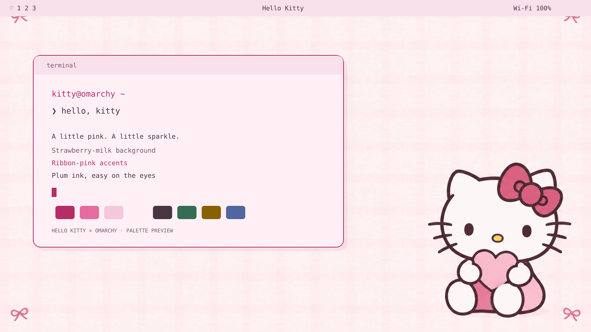
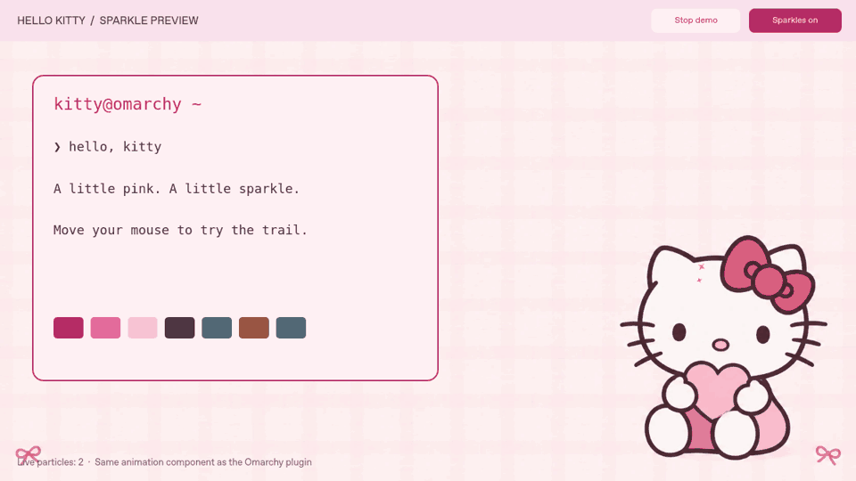

# Hello Kitty for Omarchy

Strawberry-milk terminals, ribbon-pink menus, plum text, Hello Kitty wallpaper,
and optional pink-and-gold sparkles that follow your mouse.



This repository is a **theme plus an optional shell plugin**, not an Omarchy fork.
The preview is an illustration of the included artwork and palette, not a live desktop screenshot.

## Install the pink theme

Run this in a terminal on your Omarchy computer:

```bash
omarchy theme install https://github.com/lostviolinist/omarchy-hello-kitty-theme.git
```

If your installation uses the older command spelling:

```bash
omarchy-theme-install https://github.com/lostviolinist/omarchy-hello-kitty-theme.git
```

The theme installer activates **Hello Kitty**. The pale pink background,
plum foreground, and pink selection/accent colors also apply to Omarchy-managed
Foot, Ghostty, Alacritty, and Kitty terminals through Omarchy's templates.
Open a new terminal if an existing one hasn't refreshed. Individual applications
that set their own colors can still override the terminal palette.

Requires an Omarchy release with `colors.toml` support. Shell styling and the
sparkle plugin target **Omarchy 4.x / Quattro**, with instructions checked against
the 4.5 documentation. On Omarchy 3.x, leave the sparkle plugin disabled.

The theme has no custom terminal launch commands, Lua configuration, or install
hooks. Omarchy generates application settings from the palette.

## Turn on cursor sparkles

The theme install only changes appearance. Install the optional plugin separately:

```bash
omarchy plugin add https://github.com/lostviolinist/omarchy-hello-kitty-theme.git --enable
```

Read and accept Omarchy's normal plugin prompt. This loads the sparkle service
inside the existing Omarchy shell; it does not replace the cursor or start a
second desktop shell. Python 3 is the only helper dependency.

Tiny pink and gold stars fade over about half a second. The overlay passes mouse
clicks through and never requests keyboard focus. It supports multiple monitors,
negative monitor positions, scaling, and rotation. It caps live particles at 72,
samples at 30 Hz while moving, and reduces polling to 5 Hz after a second idle.
Omarchy's reduced-motion setting suspends the effect.

Disable and re-enable at any time:

```bash
omarchy plugin disable lostviolinist.hello-kitty-sparkles
omarchy plugin enable lostviolinist.hello-kitty-sparkles
```

These controls are also under **Setup → Plugins → Disable / Enable**.
Disabling stops the helper and removes its overlays. Enabling persists across logins.

**Status:** the actual sparkle component was run in a native Qt window on an
Xfce desktop. Motion, fading, and the off/on switch worked. Automated checks
cover the palette, manifest, QML syntax, particle geometry, and cursor IPC logic.
The full Hyprland overlay still needs a live check on Omarchy; see
[validation notes](docs/VALIDATION.md).



This animation uses the same sparkle component as the plugin. Its terminal is
a palette demonstration, not a running terminal or full Omarchy session.

## Finish the look

On Omarchy 4.5:

- Choose **Appearance → Window Corners → Rounded**.
- For a solid pink terminal, use **Appearance → Window Transparency → Opaque**.
- Choose the Hello Kitty image in **Appearance → Background**.
- Choose **Hello Kitty** in **Appearance → Unlock** for the optional boot/unlock artwork.
- For the screensaver, use **Appearance → Branding → Screensaver → Set From Image**
  and select `~/.config/omarchy/themes/hello-kitty/unlock.png`.

Unlock artwork is a separate choice because it changes the boot/login branding.
The theme supplies the artwork and preview; selecting it uses Omarchy's own installer.
Older releases may call the Appearance menu **Style**.

## Update or go back

The theme and plugin are separate clones when both are installed. Update each:

```bash
git -C ~/.config/omarchy/themes/hello-kitty pull --ff-only
omarchy theme set hello-kitty
omarchy plugin update lostviolinist.hello-kitty-sparkles
```

To return to your previous look, select another theme in the Appearance menu and
disable the sparkle plugin. A theme switch alone does not disable sparkles.
To remove the plugin:

```bash
omarchy plugin remove lostviolinist.hello-kitty-sparkles
```

## Customize

| File | What it controls |
| --- | --- |
| `colors.toml` | Shared palette, including the terminal colors |
| `shell.toml` | Bar, menus, notifications, and lock input colors |
| `icons.theme` | Magenta file-manager folder icons |
| `backgrounds/01-hello-kitty.webp` | Desktop wallpaper |
| `unlock.png` | Transparent Hello Kitty boot/unlock emblem |
| `manifest.json` | Optional cursor sparkle plugin registration |
| `extras/sparkles/Service.qml` | Sparkle size, lifetime, density, and rendering |
| `extras/sparkles/cursor-feed.py` | Local Hyprland cursor sampling |

Edit the source repo, commit your changes, then update both installed copies as
needed. Keep personal changes committed before pulling updates.

The original visual assets were generated for this theme. This is an unofficial
fan project, not affiliated with Sanrio. Hello Kitty and related character rights
belong to Sanrio. See [asset notes](docs/ASSETS.md) and [LICENSE](LICENSE).

## Development

```bash
python3 -m unittest discover -s tests -p 'test_*.py'
node tests/particles.test.cjs
omarchy plugin validate .
```

To preview the actual animation in a normal window on another desktop, install
`PySide6-Essentials` in a Python virtual environment, then run:

```bash
python extras/preview/run-preview.py
```

Move the pointer inside the window or click **Play demo**. This preview does not
install anything into your desktop configuration.

Reference: [Omarchy theming](https://omarchy.org/manual/making-your-own-theme/),
[shell plugins](https://omarchy.org/manual/shell-plugins/), and
[Quickshell](https://quickshell.org/docs/).
